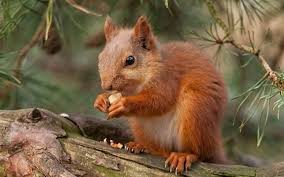

# ✨ Bienvenue ✨

## Une petite présentation

J'ai étudié les sciences naturelles pendant de nombreuses années jusqu'à obtenir le grade de Master recherche en Ecologie, Biodiversité, Evolution (EBE).
Après avoir coaché de nombreux collégiens et lycéens en les ayant aidés à réussir leurs épreuves de maths, physique-chimie ou SVT, j'ai exploré l'enseignement en collège et lycée professionnel deux ans et demi durant.

La découverte de Python au printemps 2024 m'a poussé à m'inscrire en Bachelor en informatique à l'école La Plateforme, à Marseille.

J’effectue actuellement une alternance chez Virbac en tant que développeur logiciel.

## 🛠 Outils

  - Python (MOOC Apprendre à coder avec Python - Université Libre de Bruxelles)
  - C
  - C++
  - C#
  - Java et Spring Boot
  - SQL
  - R
  - Github et Git Bash
  - HTML
  - CSS
    

## 💬 Langues parlées

## 🌱 Statistiques

## 📫 Liens

<a href=https://www.linkedin.com/in/lorenzo-ottaviani-720bab339/>  <a/>
<a href=https://lorenzo-ottaviani.github.io/portfolio/>  <a/>

<!--
**lorenzo-ottaviani/lorenzo-ottaviani** is a ✨ _special_ ✨ repository because its `README.md` (this file) appears on your GitHub profile.

Here are some ideas to get you started: 👋

- 🔭 I’m currently working on ...
- 🌱 I’m currently learning ...
- 👯 I’m looking to collaborate on ...
- 🤔 I’m looking for help with ...
- 💬 Ask me about ...
- 📫 How to reach me: ...
- 😄 Pronouns: ...
- ⚡ Fun fact: ...
-->
